# plaxis3d-automacao

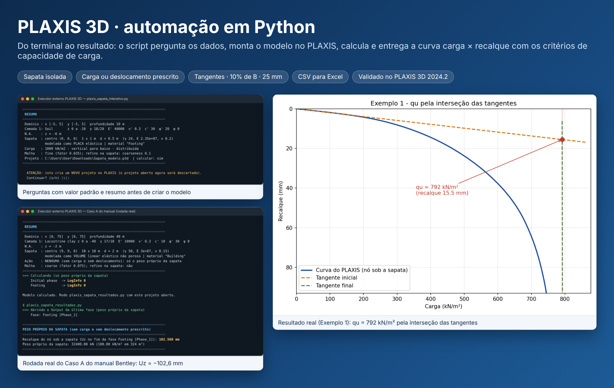

Automação do **PLAXIS 3D 2024.2** por Python: cria o modelo, calcula e extrai os resultados por scripts
**interativos** (o script pergunta os dados no terminal; Enter aceita o padrão).

O projeto nasceu de exercícios de capacidade de carga de sapatas (notas de aula) e cresceu para os
exemplos do Tutorial 1 do manual da Bentley (prédio com subsolo e radier).

## Galeria

Todas as imagens de resultado vêm de rodadas **reais** no PLAXIS 3D 2024.2 (Exemplo 1 das notas de aula e Caso A do manual da Bentley).

| Script interativo (perguntas) | Resumo antes de criar o modelo |
|---|---|
| 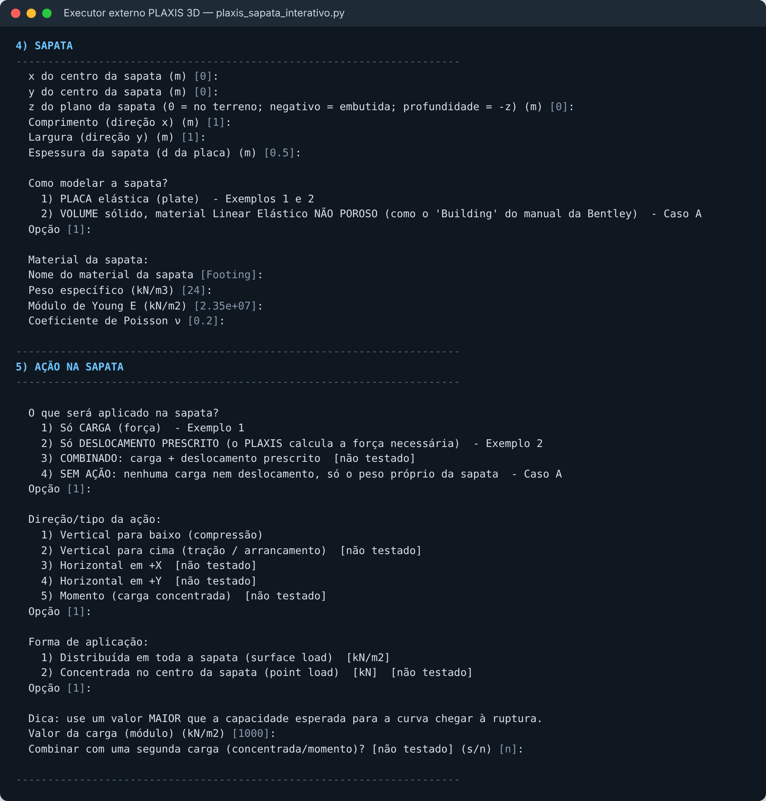 | 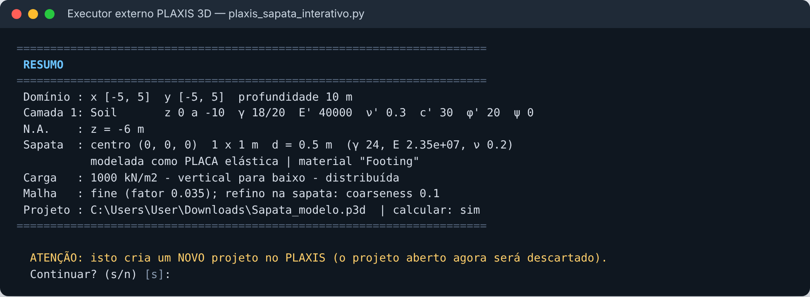 |

| Curva carga × recalque | Interseção das tangentes |
|---|---|
| 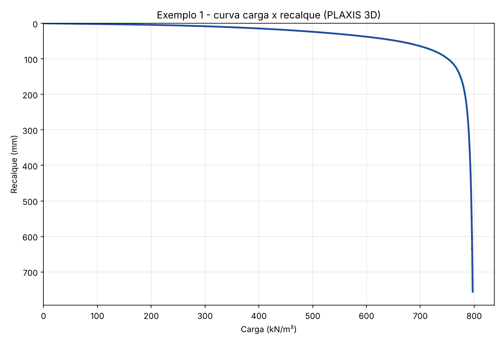 | 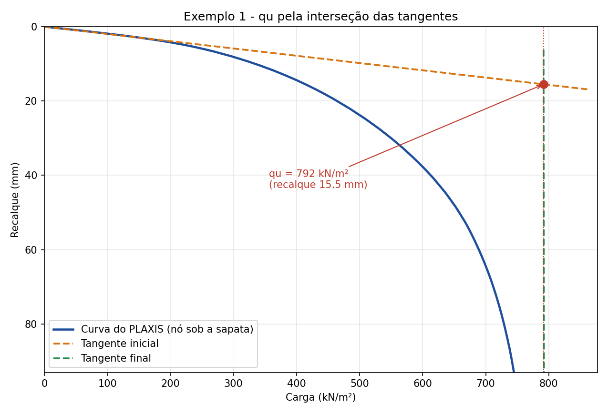 |

| Recalque = 10% de B | 25 mm (Terzaghi e Peck, 1948) |
|---|---|
| 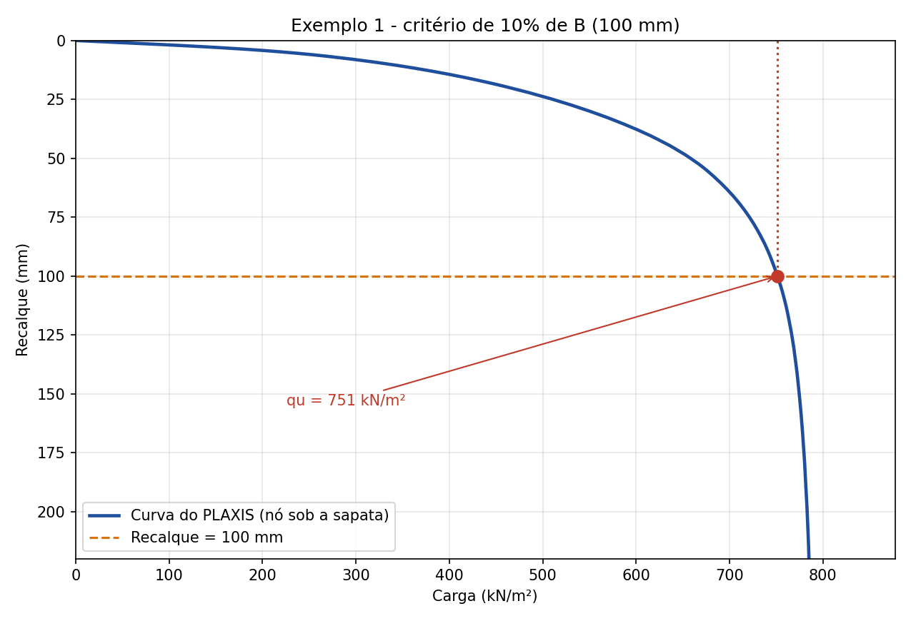 | 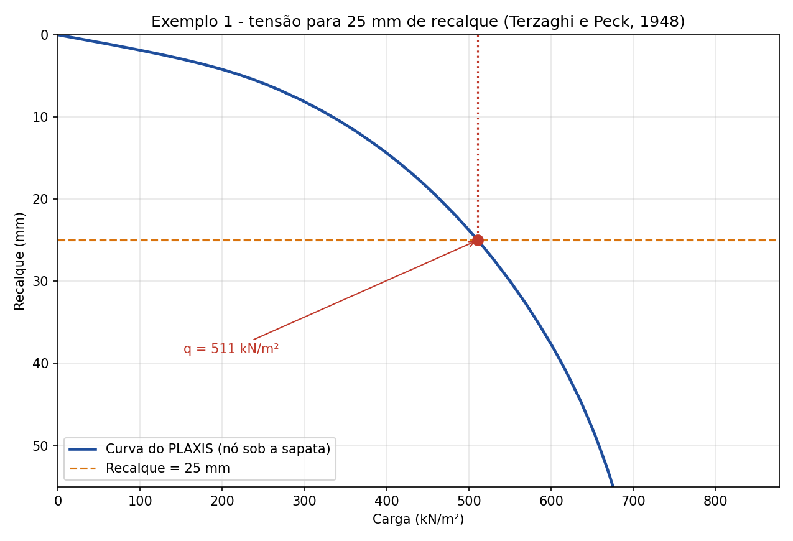 |

**Caso A do manual da Bentley** (prédio como volume linear elástico não poroso, só peso próprio):

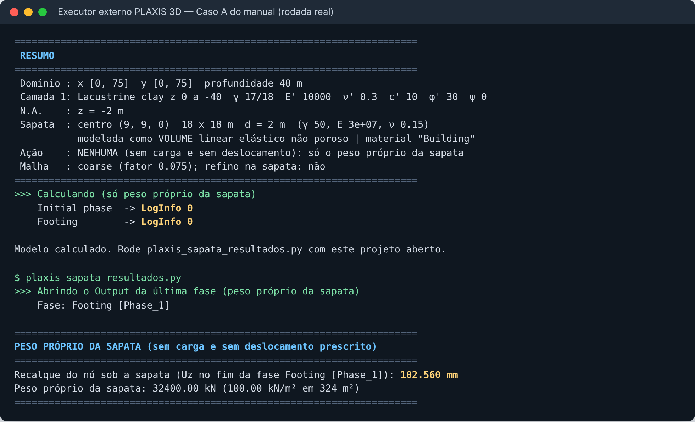

**SoilTest automático** (ensaios de laboratório virtuais; veja [`soiltest/`](soiltest/)):

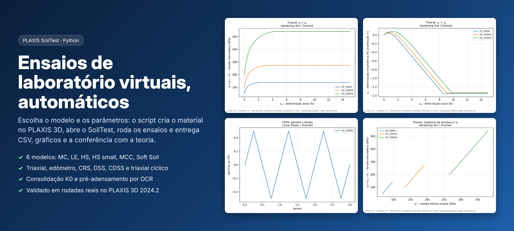

| Rodada real: HS com K0 = 0,5 e OCR = 2 | Deformação volumétrica com corte de dilatância |
|---|---|
| 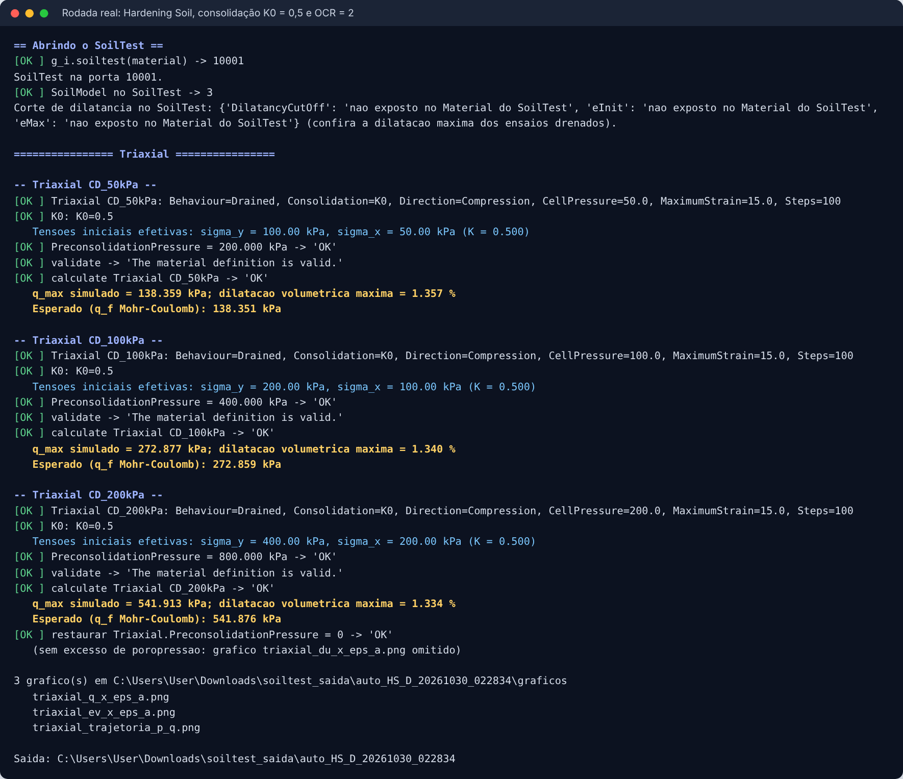 | 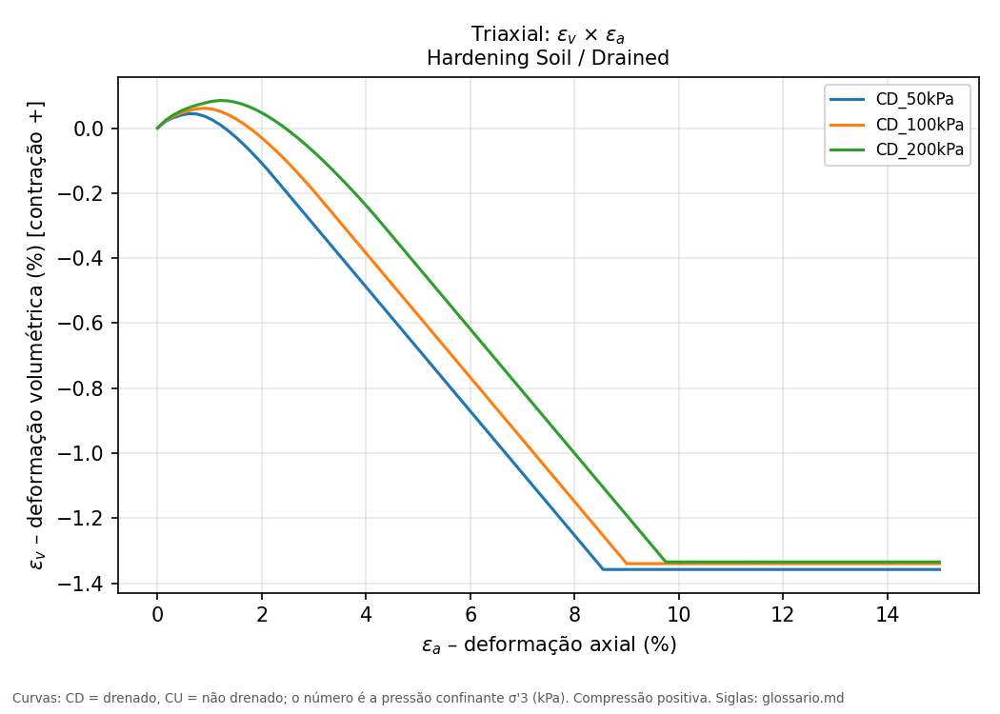 |

## Organização: do simples ao avançado

| Pasta | O que é | Status |
|---|---|---|
| [`sapata/`](sapata/) | **Sapata isolada** (placa ou volume), com carga, deslocamento prescrito, combinado ou só peso próprio. Curva carga × recalque e critérios de capacidade de carga. | **Estável**: módulos 1 e 2 validados no PLAXIS real |
| [`subsolo/`](subsolo/) | **Subsolo com radier** (Caso B do manual): escavação por fases, piso e paredes (plates), coluna e vigas (beams), cargas de superfície, de linha e pontual. | **Em desenvolvimento**: escrito pela documentação, ainda sem validação no PLAXIS real |
| [`soiltest/`](soiltest/) | **SoilTest automático**: cria o material no Input, abre o SoilTest e roda triaxial, edômetro, CRS, DSS, CDSS e triaxial cíclico em 6 modelos, com consolidação K0, OCR, CSV, gráficos e conferência com a teoria. | **Estável** (validado no PLAXIS real, inclusive cíclicos não drenados e controle por tensão); calibração em `soiltest/em_desenvolvimento/` |
| [`estudos/`](estudos/) | **Estudos de sapata**: lote a partir de Excel, sensibilidade de malha e domínio, comparação com Terzaghi, Meyerhof e Vesić e memorial de cálculo em Word/HTML. | **Novo**: testado por mock, falta rodada no PLAXIS real |
| [`ferramentas/`](ferramentas/) | Scripts de diagnóstico (somente leitura) para descobrir nomes de propriedades e inspecionar projetos. | Auxiliar |
| [`tests/`](tests/) | Teste de regressão por *mock* (roda **sem** o PLAXIS). | Ativo |
| [`docs/`](docs/) | Notas de desenvolvimento e a skill do Claude para novos projetos. | — |

## Como rodar

1. Abra o **PLAXIS 3D Input** e deixe o servidor de scripts ativo (porta 10000).
2. Rode o script pelo **executor externo** (`plaxis_script_runner.py` + `.bat`). Ele conecta no Input e entrega
   `s_i` e `g_i` ao script; a senha do servidor é pedida a cada execução.
3. Rode o script interativo da pasta desejada e responda às perguntas (ou Enter para o padrão).
4. Com o projeto calculado e aberto, rode o script de resultados da mesma pasta.

Os scripts gravam um `ultimo_modelo*.json`, o `.p3d` e os resultados (CSV/PNG) na pasta de onde rodam.

## Testes (sem PLAXIS)

```bash
./tests/regressao.sh            # compara com tests/baselines/
./tests/regressao.sh --gravar   # atualiza as linhas de base (só depois de revisar a mudança)
```

Regra do projeto: **nada que já foi validado pode mudar de comportamento.** Toda mudança em `sapata/`
precisa manter a regressão idêntica; funções novas entram como opções com padrão equivalente ao anterior.

## Fluxo de trabalho sugerido

- `main`: sempre funcionando. Cada versão estável recebe uma *tag* (`sapata-v1.0.0`, ...).
- Trabalho novo em branches `feat/...` (ou `subsolo/...`); mescla em `main` quando validado no PLAXIS real.
- Itens "[não testado]" nos scripts são os que ainda dependem de validação; veja o `README.md` de cada pasta.
- Para acompanhar pendências, use *Issues* e, se quiser um quadro, um *GitHub Project* ligado ao repositório.
